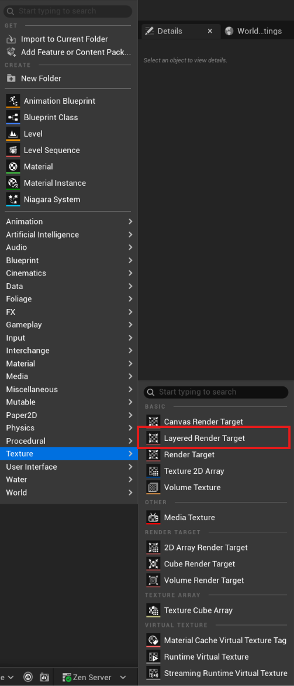
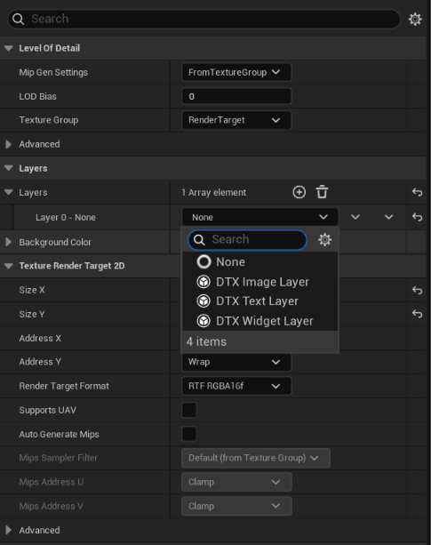
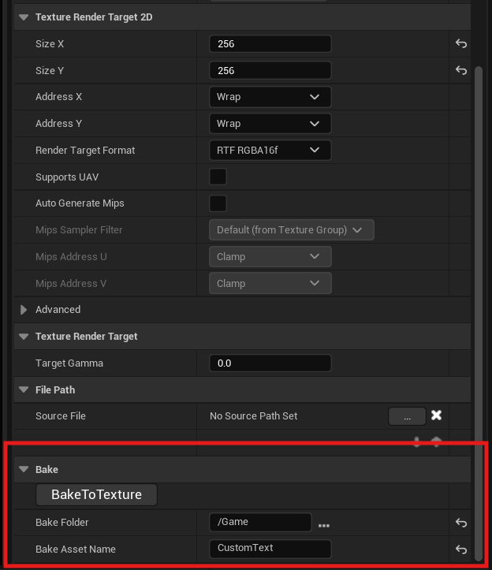
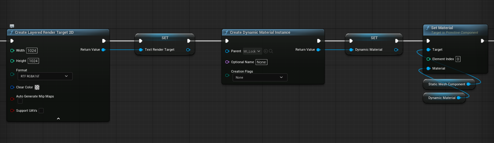
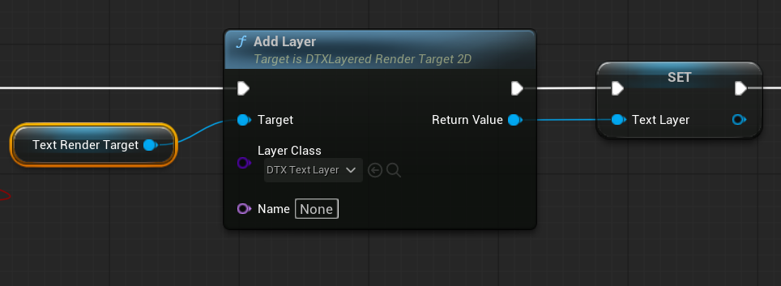
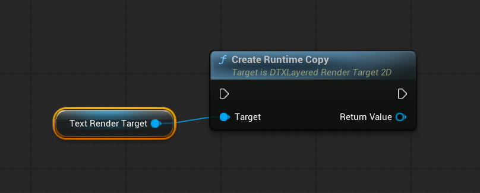

# UE5-DynamicTextTexture
Official documentation for the Dynamic Text Texture Unreal Engine plugin: setup, usage, and examples.

# Dynamic Text Texture — Documentation

Dynamic Text Texture adds a **Layered Render Target** asset: a render target that composites an ordered stack of
layers (text, images, UMG widgets, or custom C++ layers) into a texture any material can sample. Edit it in the
Details panel at edit time, or drive it from Blueprint or C++ at runtime.

**Requirements:** Unreal Engine 5.7 or later.

## Contents

1. [Installation](#1-installation)
2. [Quick start (editor)](#2-quick-start-editor)
3. [Quick start (runtime)](#3-quick-start-runtime)
4. [Concepts](#4-concepts)
5. [Text style inheritance](#5-text-style-inheritance)
6. [Updating and redrawing](#6-updating-and-redrawing)
7. [API reference](#7-api-reference)
   - [UDTXBlueprintLibrary](#udtxblueprintlibrary)
   - [UDTXLayeredRenderTarget2D](#udtxlayeredrendertarget2d)
   - [UDTXLayer](#udtxlayer)
   - [UDTXTextLayer](#udtxtextlayer)
   - [UDTXImageLayer](#udtximagelayer)
   - [UDTXWidgetLayer](#udtxwidgetlayer)
   - [Structs](#structs)
   - [Enums](#enums)
   - [Events (delegates)](#events-delegates)
8. [Custom layers in C++](#8-custom-layers-in-c)
9. [Limitations and notes](#9-limitations-and-notes)
10. [Example project](#10-example-project)

---

## 1. Installation

1. Install the plugin on [Fab](https://www.fab.com/portal/listings/30f5b3da-d12c-40c7-9a2f-29a5ef5bc744).
2. Open the project and enable **Dynamic Text Texture** under **Edit → Plugins** if it isn't already enabled.
3. Restart the editor.

C++ projects that use the API add the runtime module to their `.Build.cs`:

```csharp
PublicDependencyModuleNames.AddRange("DTX");
```

| Module | Type | Contents |
|---|---|---|
| `DTX` | Runtime | The asset, layer classes and Blueprint library. |
| `DTXEditor` | Editor | Content Browser factory and Details panel customization. |

---

## 2. Quick start (editor)

1. In the Content Browser, right-click → **Texture → Layered Render Target**. Now the New asset Layered Render Target act as a normal Texture Render Target with some extra configs.



2. Open the asset. In **Layers**, click **+** and pick a layer type (Text, Image, Widget) from the class picker. For a Text layer, set its **Text**, **Font Family**, **Font Size** and **Text Color** while Image Layer can set its **Texture2D** or Widget Layer can set a UserWidget.



That's it, from now Layered Redner Target can be used in material by drag/drop into material graph as texture2d or in blueprint.

To save the result as a regular static texture, scroll down to the bottom of **Details Panel** or search **Bake** then select the save path and fill the asset name fields **Bake Folder / Bake Asset Name** and click **Bake To Texture** the result will be a Texture2D asset save at the path.



---

## 3. Quick start (runtime)

### Blueprint

The Layered Render Target and it Layers also can be create during runtime like Texture Render Target.



Then its Layer can be add later through `Add Layer` node which returns the layer already cast to the passed class, so its setters can be called directly.



By default to any render target act like a shared asset which apply change from all source so to edit an asset was authored in the editor, make a copy first so the shared asset is not changed.



### C++

```cpp
#include "DTXBlueprintLibrary.h"
#include "DTXLayeredRenderTarget2D.h"
#include "DTXTextLayer.h"
#include "DTXImageLayer.h"

UDTXLayeredRenderTarget2D* Texture = UDTXBlueprintLibrary::CreateLayeredRenderTarget2D(this, 512, 256);

UDTXImageLayer* Background = Cast<UDTXImageLayer>(Texture->AddLayer(UDTXImageLayer::StaticClass(), "Background"));
Background->SetTint(FLinearColor(0.05f, 0.05f, 0.1f));

UDTXTextLayer* Label = Cast<UDTXTextLayer>(Texture->AddLayer(UDTXTextLayer::StaticClass(), "Label"));
Label->SetText(TEXT("Hello"));
Label->SetFontSize(48.f);

MaterialInstance->SetTextureParameterValue("Texture", Texture);
```

---

## 4. Concepts

### Layer stack

`Layers` is an ordered array. **Index 0 is drawn at the bottom**, and each later layer is alpha-blended over it.
The texture is cleared to `BackgroundColor` before every draw.

### Frame (where a layer is drawn)

Every layer has a `Frame` in **normalized canvas coordinates** (0 – 1):

- `Position` — top-left corner. `(0, 0)` is the top-left of the texture.
- `Size` — width and height. `(1, 1)` fills the texture. A **negative** axis spans back from `Position` and
  **mirrors** the layer. A zero axis hides the layer.

Inside the frame:

- `Padding` — pixel margin between the frame edge and the content. Content is clipped to the frame.
- `RenderTransform` — translation, scale, shear and angle, like UMG's Render Transform.
- `RenderTransformPivot` — normalized point inside the frame that scale, shear and angle pivot around
  (`(0.5, 0.5)` = center).
- `Opacity` — 0 – 1.

### Layer types

| Class | Shows |
|---|---|
| `UDTXLayer` | Base class of all layers. |
| `UDTXTextLayer` | Text with font, color, alignment, outline, shadow, wrapping, and style inheritance. |
| `UDTXImageLayer` | A texture, render target, UI material, or a flat tinted box. |
| `UDTXWidgetLayer` | Any UMG User Widget. This is the way to build custom layers in Blueprint. |


---

## 5. Text style inheritance

Text layers can share a style. A Text layer's **Inherit Style From** setting picks a parent:

| Value | Parent |
|---|---|
| **Nothing** | No parent. The layer uses all of its own values. |
| **Previous Text Layer** (default) | The nearest Text layer below it (lower index). Other layer types are skipped. |
| **Specific Layer** | The Text layer at `InheritIndex`, which must be below this one. |

When a Text Layer **has a parent(An another Text Layer in the array above this one)**, each style field shows a checkbox (`bOverride_X`). Checked fields use this layer's
value; unchecked fields come from the parent. Parents can themselves inherit, so styles chain down the stack.

When a layer **has no parent**, the checkboxes are hidden and every field is used.

Example: layer 0 is a title with a custom font, size 48, white. Layer 1 inherits from it and only overrides
**Text** and **Font Size** (24), so it keeps the font and color. Change the title's font and both layers update.

> `InheritIndex` follows the **index**, not the layer. After inserting or moving layers it points at whatever is at
> that index now.

---

## 6. Updating and Redrawing

Manual redraws are normally unnecessary: **every setter and Details edit redraws automatically**.
Redraws are batched and run at most once per frame.

Some changes are cheap (**repaint**): `Opacity`, `RenderTransform`, `RenderTransformPivot`. These are safe to animate
every frame from Tick or a Timeline. Everything else **rebuilds** the layer content, which costs more.
`BackgroundColor` and size changes also recreate the GPU texture, so avoid animating them.

Changes the plugin cannot see need a manual redraw:

| Change | Call |
|---|---|
| Parameters on a material instance used by a layer (`GetDynamicMaterial`) | `MarkDirty` on the texture, or enable the layer's `bLive` |
| Variables or children of a Widget layer's User Widget | `RequestRedraw` on the layer |
| A UMG animation or an animated material | Enable `bLive` on the layer (repaints every frame) |
| The texture size via `ResizeTarget` | `MarkDirty` on the texture |
| Anything, with the pixels needed this frame | `RedrawNow` |

From inside a User Widget, `Get Widget Layer (Self)` returns the layer showing it, so the widget can call
`RequestRedraw` on itself.

---

## 7. API reference

All functions below are Blueprint-callable unless marked **C++ only**.

### UDTXBlueprintLibrary

**`CreateLayeredRenderTarget2D`** → `UDTXLayeredRenderTarget2D*`

Creates an empty layered render target, like **Create Render Target 2D**. Returns null if Width or Height is not positive or there is no world. Fill it with `AddLayer`.

- `WorldContextObject`
- `Width` = 256
- `Height` = 256
- `Format` = `RTF_RGBA16f`
- `ClearColor` = transparent. Sets `BackgroundColor`.
- `bAutoGenerateMipMaps` = `false`
- `bSupportUAVs` = `false`

<Image>

### UDTXLayeredRenderTarget2D

The asset. Inherits `UTextureRenderTarget2D`, so it can be used anywhere a texture or render target can.
It is a linear texture: sample it with **Sampler Type = Linear Color**.

**Properties**

| Property | Type | Description |
|---|---|---|
| `Layers` | `TArray<UDTXLayer*>` | The layer stack, index 0 at the bottom. Read-only in Blueprint: use the functions below so events fire. |
| `BackgroundColor` | `FLinearColor` | Cleared to before every draw. Setter: `SetBackgroundColor`. Recreates the GPU texture when changed. |
| `BakeFolder` | `FDirectoryPath` | Editor only. Folder for `BakeToTexture`. Defaults to the asset's folder. |
| `BakeAssetName` | `FString` | Editor only. Name of the baked texture. |

**Layer stack**

| Function | Description |
|---|---|
| `AddLayer(LayerClass, Name = None) → UDTXLayer*` | Adds a layer of `LayerClass` on top. A `None` name uses the class display name ("Text", "Image"). Blueprint output is typed to `LayerClass`. |
| `InsertLayer(LayerClass, Index, Name = None) → UDTXLayer*` | Same, at `Index` (clamped to `[0, Num]`). |
| `RemoveLayer(Layer) → bool` | Removes a layer. |
| `RemoveLayerAt(Index) → bool` | Removes the layer at `Index`. |
| `MoveLayer(FromIndex, ToIndex) → bool` | Moves a layer. `ToIndex` is its final index. |
| `GetLayer(Index) → UDTXLayer*` | Layer at `Index`, or null. |
| `FindLayerByName(Name) → UDTXLayer*` | First (lowest-index) layer with that name. Names are not unique. |
| `IndexOfLayer(Layer) → int32` | Index of `Layer`, or -1. |
| `GetLayerCount() → int32` | Number of layers. |

**Drawing**

| Function | Description |
|---|---|
| `MarkDirty()` | Queues a full rebuild for the next frame. Call after editing material instance parameters or resizing. |
| `MarkDirty(bool bRebuild)` | **C++ only.** `false` only repaints (enough for opacity/transform changes). |
| `RedrawNow()` | Draws immediately, so the pixels are ready this frame. |
| `SetBackgroundColor(Color)` | Sets `BackgroundColor`. |
| `CreateRuntimeCopy() → UDTXLayeredRenderTarget2D*` | Transient duplicate with its own layers and no bound events. Recommended at runtime: edit the copy and leave the authored asset untouched. |
| `BakeToTexture()` | **Editor only** (button in Details). Renders the current layers into a static `Texture2D` at `BakeFolder/BakeAssetName`, overwriting an existing one. |

**Events:** `OnPreRedraw`, `OnPostRedraw`, `OnLayersChanged` — see [Events](#events-delegates).

### UDTXLayer

Abstract base class of every layer. All layer types have these members.

**Properties** (each has a setter of the same name, e.g. `SetOpacity`)

| Property | Type | Default | Description |
|---|---|---|---|
| `Name` | `FName` | class name | Used by `FindLayerByName`. |
| `bVisible` | `bool` | `true` | Hidden layers are not drawn. |
| `Opacity` | `float` | `1` | 0 – 1. Repaint only: safe to animate. |
| `Frame` | `FDTXLayerFrame` | full canvas | The layer's rect, normalized. See [Frame](#frame-where-a-layer-is-drawn). |
| `Padding` | `FMargin` | 0 | Pixels inside the rect. |
| `RenderTransform` | `FWidgetTransform` | identity | Translation, scale, shear, angle. Repaint only. |
| `RenderTransformPivot` | `FVector2D` | `(0.5, 0.5)` | Normalized pivot within the rect. Repaint only. |
| `bLive` | `bool` | `false` | Repaints every frame while visible (animated materials, UMG animations). Costs one render per frame for the asset. |

**Functions**

| Function | Description |
|---|---|
| `SetName`, `SetVisible`, `SetOpacity`, `SetFrame`, `SetPadding`, `SetRenderTransform`, `SetRenderTransformPivot`, `SetLive` | Setters for the properties above. Each redraws automatically. |
| `RequestRedraw(bRebuild = false)` | Redraws on the next frame, for changes the setters don't see. `bRebuild = true` rebuilds the content; leave it off when the existing content already shows the new state. |
| `RedrawNow(bRebuild = false)` | `RequestRedraw`, then draws immediately. |
| `GetOwningTexture() → UDTXLayeredRenderTarget2D*` | The texture holding this layer, or null once removed. |
| `GetLayerIndex() → int32` | This layer's index, or -1 once removed. |
| `BuildContent(Context) → TSharedRef<SWidget>` | **C++ only, virtual.** Builds the layer's Slate content. See [Custom layers](#8-custom-layers-in-c). |
| `WantsContinuousRedraw() → bool` | **C++ only, virtual.** `true` keeps repainting every frame. Defaults to `bLive`. |

**Events:** `OnLayerChanged`, `OnLayerRedrawn` — see [Events](#events-delegates).

### UDTXTextLayer

Displayed as **DTX Text Layer**. Draws text.

**Properties** (each has a setter of the same name)

| Property | Type | Default | Description |
|---|---|---|---|
| `Inherit` | `EDTXTextInherit` | Previous Text Layer | Which Text layer supplies non-overridden fields. See [inheritance](#5-text-style-inheritance). |
| `InheritIndex` | `int32` | 0 | Parent index when `Inherit` is Specific Layer. |
| `Text` | `FString` | | The text. Shift+Enter for new lines in the Details panel. |
| `FontFamily` | `UFont*` | engine font | Must be a **runtime-cached** font. |
| `Typeface` | `FName` | Regular | Typeface in the font family (Regular, Bold…). |
| `FontSize` | `float` | 24 | |
| `TextColor` | `FLinearColor` | white | A Font Material only uses it if it reads **Vertex Color**. |
| `HorizontalAlignment` | `ETextJustify` | Center | Left, Center, Right. |
| `VerticalAlignment` | `EVerticalAlignment` | Center | Top, Center, Bottom. |
| `Case` | `ETextTransformPolicy` | None | None, To Lower, To Upper. |
| `LetterSpacing` | `int32` | 0 | In 1/1000 em, like UMG. |
| `LineSpacing` | `float` | 1 | Multiplier of the font's line height. |
| `bStrikethrough` | `bool` | `false` | Drawn in the text color. Setter: `SetStrikethrough`. |
| `FontMaterial` | `UMaterialInterface*` | | Glyph fill material. Must be **User Interface** domain. |
| `Outline` | `FFontOutlineSettings` | none | Outline size, color, material. Size 0 disables it. Setter: `SetOutlineSettings`. |
| `Shadow` | `FDTXTextShadow` | disabled | Drop shadow. |
| `bWrapText` | `bool` | `false` | Wraps at the layer's content width. Setter: `SetWrapText`. |
| `bShrinkToFit` | `bool` | `false` | Scales text down (never up) to fit the content rect. Disables wrapping; meant for single-line text. Setter: `SetShrinkToFit`. |
| `WrappingMode` | `ETextWrappingPolicy` | Default | |
| `Overflow` | `ETextOverflowPolicy` | Clip | Clip or Ellipsis, at the layer's edge. |
| `TextDirection` | `ETextFlowDirection` | Auto | Left-to-right / right-to-left. |
| `bOverride_<Field>` | `bool` | `false` | Per field: use this layer's value instead of the parent's. Only matters when the layer has a parent. |

**Functions**

| Function | Description |
|---|---|
| `SetText`, `SetFontFamily`, `SetTypeface`, `SetFontSize`, `SetTextColor`, `SetHorizontalAlignment`, `SetVerticalAlignment`, `SetCase`, `SetLetterSpacing`, `SetLineSpacing`, `SetStrikethrough`, `SetFontMaterial`, `SetOutlineSettings`, `SetShadow`, `SetWrapText`, `SetShrinkToFit`, `SetWrappingMode`, `SetOverflow`, `SetTextDirection`, `SetInherit`, `SetInheritIndex` | Setters. |
| `SetOutline(OutlineSize, OutlineColor)` | Shortcut for the outline size and color. Size 0 disables it. |
| `GetOwnStyle() → FDTXTextStyle` | **C++ only.** This layer's own values, ignoring inheritance. |
| `ResolveStyle() → FDTXTextStyle` | **C++ only.** The final style after inheritance. |
| `ResolveStyle(Parent) → FDTXTextStyle` | **C++ only.** This layer's overrides applied over `Parent`. |
| `FindParentLayer() → const UDTXTextLayer*` | **C++ only.** The parent per `Inherit`, or null. |

> Calling a setter (e.g. `SetText`) also sets the matching `bOverride_X`, so the new value wins over the parent's.
> Editing a field in the Details panel does the same.

### UDTXImageLayer

Displayed as **DTX Image Layer**. Fills its frame with a texture, a UI material, or a flat tint.

| Property | Type | Description |
|---|---|---|
| `Brush` | `FSlateBrush` | The resource and how it's drawn (Image, Box, Border, Rounded Box), tint, tiling, margins. Accepts `Texture2D`, render targets (including another Dynamic Text Texture), `Texture2DDynamic`, or a **User Interface** domain material. With no resource it fills with the tint; use **Draw As = Rounded Box** for rounded boxes. Setter: `SetBrush`. |

| Function | Description |
|---|---|
| `SetBrush(Brush)` | Replaces the whole brush. |
| `SetTexture(Texture)` | Sets the brush resource to a texture. |
| `SetMaterial(Material)` | Sets the brush resource to a UI material. |
| `SetTint(Color)` | Sets the brush tint. |
| `SetTiling(Tiling, TileSize)` | Tiling mode and tile size in pixels. |
| `GetDynamicMaterial() → UMaterialInstanceDynamic*` | Creates (once) and returns a dynamic instance of the brush material. Null if the brush has no material. Parameter changes don't redraw on their own: call `MarkDirty` on the texture or enable `bLive`. |

A layer can't show its own texture; that is rejected with a warning.

### UDTXWidgetLayer

Displayed as **DTX Widget Layer**. Fills its frame with a UMG User Widget. This is the way to make a custom layer in
Blueprint. The widget instance is created on first draw and kept until `WidgetClass` changes, so its variables
survive redraws.

| Property | Type | Description |
|---|---|---|
| `WidgetClass` | `TSubclassOf<UUserWidget>` | The widget to show. Setter: `SetWidgetClass`. |

| Function | Description |
|---|---|
| `SetWidgetClass(Class)` | Changes the widget (creates a new instance). |
| `GetWidget() → UUserWidget*` | The live instance, e.g. to set its variables. Call `RequestRedraw` after editing it. Null without a `WidgetClass`. |
| `GetWidgetLayer(Widget) → UDTXWidgetLayer*` | **Static.** The layer showing `Widget` (defaults to Self), so the widget can redraw itself. Null otherwise. |

> The widget is drawn without a world or player. Avoid nodes that need one, such as `Get Owning Player` or latent
> actions like `Delay`.

### Structs

**`FDTXLayerFrame`** — a layer's rect, normalized to the canvas.

| Field | Type | Default | Description |
|---|---|---|---|
| `Position` | `FVector2D` | `(0, 0)` | Top-left corner. |
| `Size` | `FVector2D` | `(1, 1)` | Width, height. Negative mirrors; zero hides. |

**`FDTXTextShadow`** — drop shadow of a Text layer.

| Field | Type | Default | Description |
|---|---|---|---|
| `bEnabled` | `bool` | `false` | |
| `Offset` | `FVector2D` | `(1, 1)` | In pixels. |
| `Color` | `FLinearColor` | black | |

**`FDTXTextStyle`** (C++ only) — a fully resolved text style, returned by `GetOwnStyle` and `ResolveStyle`. Fields:
`Text`, `Case`, `Font` (`FSlateFontInfo`, includes size, typeface, letter spacing, outline, font material),
`TextColor`, `HorizontalAlignment`, `VerticalAlignment`, `LineSpacing`, `bWrapText`, `bShrinkToFit`, `WrappingMode`,
`Overflow`, `TextDirection`, `bStrikethrough`, `Shadow`.

**`FDTXLayerBuildContext`** (C++ only) — passed to `UDTXLayer::BuildContent`.

| Field | Type | Description |
|---|---|---|
| `Texture` | `const UDTXLayeredRenderTarget2D*` | The texture being drawn. |
| `LayerIndex` | `int32` | This layer's index. |
| `CanvasSize` | `FVector2D` | Texture size in pixels. |
| `ContentSize` | `FVector2D` | Pixel size of the layer's rect minus `Padding` (e.g. the text wrap width). |

### Enums

**`EDTXTextInherit`** — `None` (shown as Nothing), `PreviousTextLayer`, `LayerIndex` (shown as Specific Layer).

**`EDTXLayerChange`** — `Added`, `Removed`, `Moved`, `Reset` (undo, Details-panel array edits, or unknown changes).

### Events (delegates)

| Event | On | Parameters | Fires |
|---|---|---|---|
| `OnPreRedraw` | texture | `Texture` | Before every draw. Always paired with `OnPostRedraw`. |
| `OnPostRedraw` | texture | `Texture` | After every draw, when the pixels are ready. |
| `OnLayersChanged` | texture | `Texture, Change, Layer, OldIndex, NewIndex` | When layers are added, removed or moved. `OldIndex` is -1 for Added, `NewIndex` is -1 for Removed, both are -1 and `Layer` is null for Reset. |
| `OnLayerChanged` | layer | `Layer, PropertyName` | When any setter or Details edit changes the layer. `PropertyName` is None when unknown. Not fired by live repaints or `RequestRedraw`. |
| `OnLayerRedrawn` | layer | `Layer` | After a draw that showed a change to this layer, before `OnPostRedraw`. |

`RedrawNow` called from inside these events is queued for the next frame instead of drawing recursively.

---

## 8. Custom layers in C++

Subclass `UDTXLayer` and override `BuildContent` to return any Slate widget. It fills the layer's frame (minus
`Padding`). The new class appears in the Details panel's layer class picker automatically.

```cpp
#include "DTXLayer.h"
#include "Widgets/Images/SImage.h"
#include "MyColorLayer.generated.h"

UCLASS(meta = (DisplayName = "My Color Layer"))
class UMyColorLayer : public UDTXLayer
{
	GENERATED_BODY()

public:
	UPROPERTY(EditAnywhere, BlueprintReadWrite, BlueprintSetter = SetColor, Category = "My Layer")
	FLinearColor Color = FLinearColor::Red;

	UFUNCTION(BlueprintSetter, Category = "My Layer")
	void SetColor(FLinearColor InColor)
	{
		Color = InColor;
		MarkChanged(GET_MEMBER_NAME_CHECKED(UMyColorLayer, Color)); // redraws and fires OnLayerChanged
	}

	virtual TSharedRef<SWidget> BuildContent(const FDTXLayerBuildContext& Context) override
	{
		return SNew(SImage).ColorAndOpacity(Color);
	}
};
```

Rules:

- `BuildContent` must not change layer state.
- Call `MarkChanged(PropertyName)` from the subclass setters. Pass `bRebuild = false` when the existing widgets already show
  the change.
- Edits in the Details panel redraw automatically.
- Override `WantsContinuousRedraw` to return `true` while the layer needs a repaint every frame.
- Use `IsUIMaterial(Material)` to validate incoming materials.

---

## 9. Limitations and notes

- **Fonts:** only runtime-cached `UFont` assets are supported. Offline fonts fall back to the engine default font
  with a warning.
- **Materials:** font, outline and image materials must use the **User Interface** material domain. Others are
  ignored with a warning.
- **Sampling:** the texture is linear. Set the material Texture Sample's **Sampler Type** to **Linear Color**.
- **No Slate, no drawing:** nothing is drawn on dedicated servers, during cooking, or in commandlets.
- **Runtime edits:** editing the authored asset in PIE changes the asset itself. Use `CreateRuntimeCopy`.
- **Resizing:** after `ResizeTarget`, call `MarkDirty`.
- **Not network replicated.** Drive each client's texture locally.
- **Cost:** each redraw renders the whole layer stack once. Many textures with `bLive` layers each render every frame.

---

## 10. Example project

The [`examples/DTX_Example`](examples/DTX_Example) project shows the plugin in use: Text, Image and Widget layers,
Blueprint-driven updates, and data-asset-driven content. Open `Content/DTX/Levels/Example.umap`.

